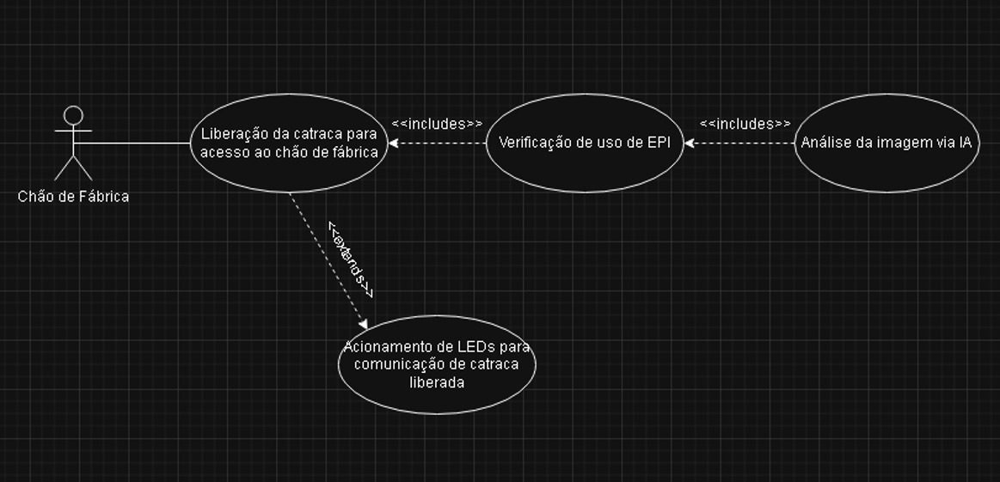
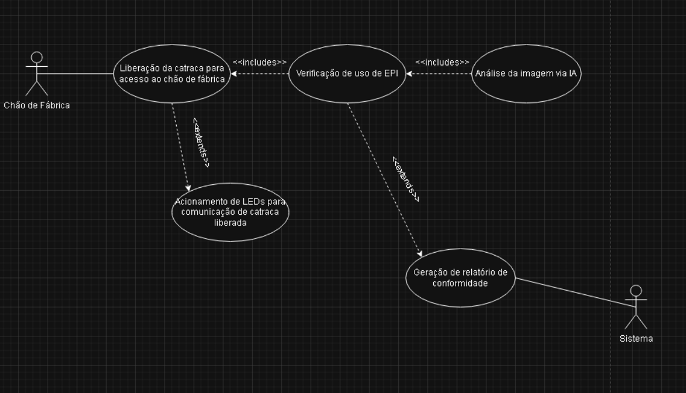
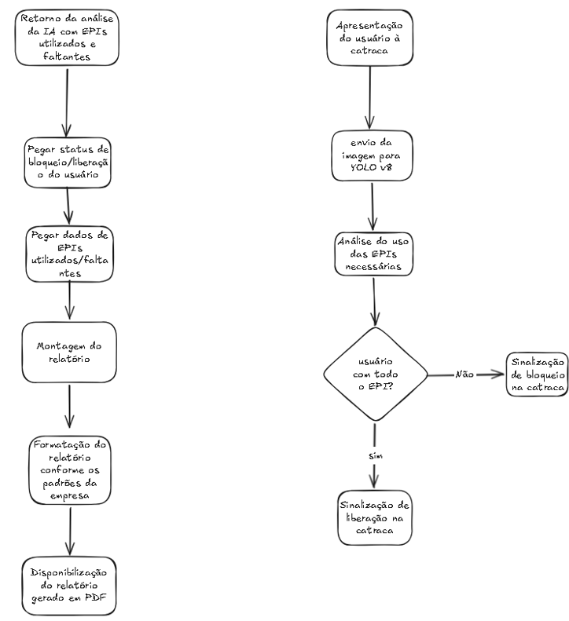

# SentraVision

**Sistema Inteligente de Monitoramento de EPIs com Visão Computacional**

---

## 👥 Integrantes

- **Breno Ferreira e Silva** - RM 555503
- **Enzo Raddatz** - RM 556312
- **Felipe Chiozzotto Gozzani** - RM 554715
- **Rafael Lopes Bestilleiro Benedetti** - RM 554781
- **Vinicius de Abreu Fernandes** - RM 558184
- **Pedro Gonçalves**

---

## ⚠️ Problema Abordado

Dentro de fábricas e ambientes industriais, o uso incorreto ou a ausência de Equipamentos de Proteção Individual (EPIs) ainda é um dos principais fatores que contribuem para acidentes de trabalho. Muitas vezes, funcionários deixam de utilizar itens essenciais, como capacetes, luvas, óculos de proteção e coletes, seja por descuido, pressa ou até mesmo falta de fiscalização constante.

Esse problema pode gerar acidentes graves, colocando em risco a segurança dos trabalhadores e causando prejuízos para a empresa, como afastamentos, processos e redução da produtividade. Atualmente, grande parte da fiscalização depende apenas da supervisão humana, o que pode falhar em ambientes muito grandes ou movimentados.

---

## 💡 Proposta de Solução

O projeto **SentraVision** tem como objetivo desenvolver um sistema inteligente capaz de identificar automaticamente se os funcionários estão utilizando os EPIs corretamente durante o trabalho.

A solução será baseada em Inteligência Artificial e Visão Computacional, utilizando câmeras instaladas no ambiente industrial para realizar o monitoramento em tempo real. A IA analisará as imagens capturadas e verificará se os equipamentos obrigatórios estão sendo utilizados adequadamente.

Caso o sistema detecte a ausência de algum EPI, ele poderá emitir alertas para supervisores ou registrar a ocorrência automaticamente, ajudando a aumentar a segurança no ambiente de trabalho e reduzindo riscos de acidentes.

---

## 🛠️ Tecnologias Selecionadas e Justificativa

Nesta etapa final (Sprint 4), optamos por uma arquitetura focada em processamento em nuvem para a prova de conceito (PoC), garantindo velocidade na inferência da IA sem a necessidade de configurações complexas de infraestrutura local.

- **Python:** Linguagem base para o pipeline de Inteligência Artificial e processamento de dados.
- **YOLOv8 (Ultralytics):** Modelo de alta velocidade para detecção de objetos (*You Only Look Once*), configurado para identificar EPIs em tempo real nas imagens capturadas.
- **OpenCV:** Utilizado para a manipulação das imagens e extração de frames.
- **Google Colab:** Ambiente de execução em nuvem utilizado para hospedar o código, processar as imagens via GPU (T4) e exibir os resultados interativos (Dashboards), substituindo a necessidade de um backend/banco de dados local para esta PoC.

---

## 📊 Diagramas

### Diagrama de Casos de Uso

### Diagrama de Atividades

### Diagrama de Classes

---

## 🚀 Resumo das Sprints

### Sprint 1: Modelagem e Casos de Uso
Levantamento do problema (ausência de EPIs na Metaindústria), definição da proposta de solução com IA e construção dos diagramas estruturais iniciais (Casos de Uso, Atividades e Classes).

### Sprint 2: Prototipação Funcional e Navegável (UX/UI)
Desenvolvimento do protótipo de alta fidelidade no Figma, focado na ergonomia industrial (Layout Vertical/Dark Mode).
- **Telas Mapeadas:** Dashboard de Monitoramento (IA em tempo real), Alerta de Riscos (Infrações), Cadastro de EPI e Relatório de Conformidade.
- 🔗 **Link do Protótipo:** [Acessar a identidade visual do projeto no Figma](https://www.figma.com/design/NPKZlvI3XsrA2Tiw77wimS/Sprint-2---ES?node-id=0-1&t=NuW2fSCNox79EamV-1)

### Sprint 3: Evolução do Protótipo e Gestão Ágil
Expansão do protótipo incorporando fluxos secundários vitais:
1. **Tela de Login (A2F):** Acesso restrito a supervisores logados (adequação LGPD).
2. **Tratativa de Ocorrência:** Tela para o supervisor registrar a ação tomada ("EPI Fornecido", "Advertência", etc.), fechando o ciclo do caso de uso.
- Implementação da gestão ágil do projeto via **Scrum** (Quadro Trello).

### Sprint 4 (Final): Validação da IA e Entrega da PoC
Consolidação dos scripts de Visão Computacional (YOLOv8) e integração do fluxo do Figma diretamente no **Google Colab** utilizando `ipywidgets`. A solução agora permite simular o fluxo completo de detecção, emissão de alertas e tratativa de ocorrências sem a dependência de um banco de dados relacional.

---

## 💻 Manual de Execução (Como testar a solução)

Para que os avaliadores possam testar o SentraVision de forma prática, estruturamos o código em um Notebook interativo.

1. **Acesse o Google Colab:**
2. **Ative a Aceleração por GPU:** No menu superior do Colab, clique em `Ambiente de execução` > `Alterar o tipo de ambiente de execução` e selecione **T4 GPU** (Hardware accelerator).
3. **Instale as Dependências:** Execute a primeira célula de código para instalar o `ultralytics` (YOLO) e o `ipywidgets`.
4. **Carregue o Modelo:** Execute as células seguintes para carregar o modelo treinado `.pt` (disponível neste repositório).
5. **Adicione uma imagem:** Adicione uma imagem e coloca o caminho no código para poder fazer o reconhecimento de EPI.
6. **Realize a Inferência:** A última célula processará a imagem/vídeo de teste (já embutida no repositório) e exibirá a interface interativa com os EPIs detectados e mapeados (*bounding boxes*).

---

## 🔗 Links Finais do Projeto

- **Board Trello (Gestão Ágil):** [TRELLO](https://trello.com/invite/b/6a9d70d9e59423228faba1af/ATTI35f28d4a79ca73d8ad730122b957514e48956915/sentravision-sprint)
